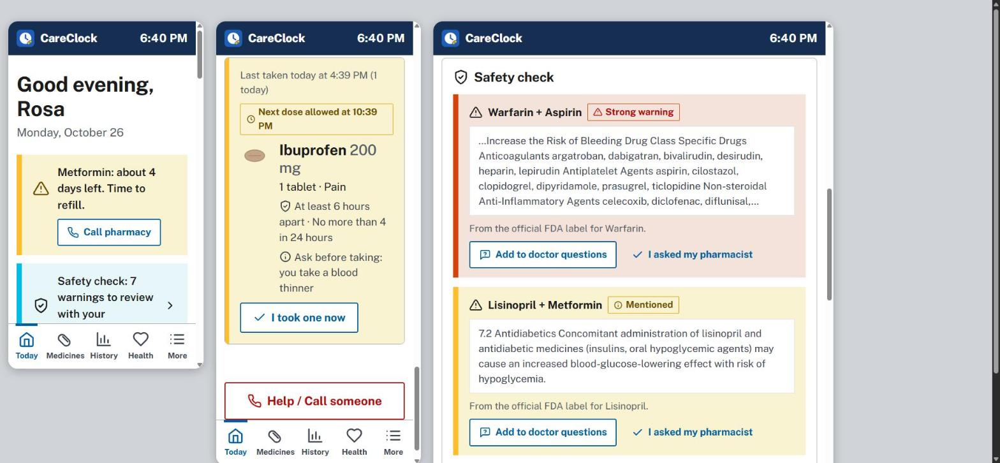
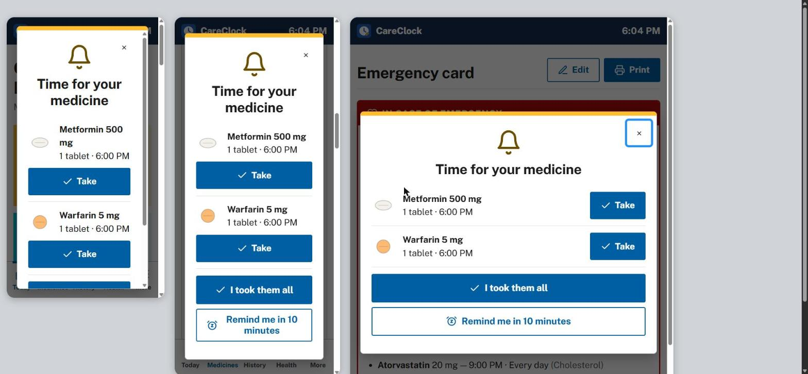

# CareClock

**Medicine reminders that older adults can actually use, and that families can trust.**

CareClock is a free web app that installs on any phone, tablet or computer. It helps older adults take the right medicine at the right time. It warns when two medicines' official FDA labels mention each other, and it gives caregivers and doctors a clear picture of what is really happening at home.

- **No account, no ads, no tracking.** Everything stays on the device.
- **Works offline.** After the first visit it works without internet.
- **Six languages:** English, Español, 中文, Tiếng Việt, Tagalog, 한국어.
- **Built for aging eyes and hands:** three text sizes, high-contrast mode, 44px+ touch targets, spoken reminders, and no color-only meaning.

> **Try it:** [fool0013.github.io/careclock](https://fool0013.github.io/careclock/) · [Open the demo with sample data](https://fool0013.github.io/careclock/#/demo)





---

## The problem

Many older adults take several medicines a day on different schedules. Mistakes are common: missed doses, double doses, running out, and combinations that shouldn't be taken together. Most reminder apps are made for younger, tech-comfortable users. They are small-print, English-only, and account-based, and they often share data with advertisers.

## What CareClock does

| Feature | Why it matters |
|---|---|
| **Today screen** with one large **Take** button per dose, grouped by morning, afternoon, evening and night. A schedule bar shows each dose's status | Nothing to figure out: the screen answers "what do I take now?" |
| **Reminders** with a chime, a spoken message in the user's language, vibration and a system notification, plus a snooze. A **calendar export** gives alarms even when the app is closed | Reminders that can be seen, heard and felt |
| **Safety check** that downloads each medicine's official **FDA label** (openFDA) and flags when one label names another medicine or its drug class, **quoting the label sentence** | Turns public federal data into a question to ask the pharmacist. Catches warfarin + aspirin, lisinopril + ibuprofen, and more |
| **Refill tracking**: counts pills down as they're taken and warns days before running out, with a one-tap call to the pharmacy | Running out means missed doses. This catches it early |
| **Pill photos** and color/shape drawings, plus **barcode / NDC lookup**: scan or type the code on the box to fill in the name, strength and form from the FDA's NDC directory | "Is this the right pill?" Less typing for shaky hands |
| **Double-dose guards**: confirms before a dose is taken more than an hour early. As-needed medicines get **minimum hours between doses** and a **24-hour limit**, with "next dose allowed at 8:20 PM". Double-taps are ignored | Prevents the most dangerous mistakes, not just forgetting |
| **Fix a forgotten tap**: mark any missed dose from the last 7 days as taken or skipped | History stays truthful, so the doctor report is right |
| **Caregiver mode**: a PIN-locked simple mode for the senior, a one-tap text summary for family ("4 of 5 taken · Missed: Metformin 6 PM") | Supports the senior without taking over |
| **Doctor report** (printable): adherence %, missed-dose pattern, vitals averages, label warnings, questions to ask | Fifteen-minute appointments go further |
| **Emergency card** with a **QR code** any phone camera can read: allergies, conditions, medicines, contacts. It works offline | For paramedics and the ER |
| **Health log** for blood pressure (with AHA categories), blood sugar and weight, with charts. Also appointments (with calendar alerts) and a questions-for-the-doctor list | One place for the whole care routine |

## How it's built

- **Languages:** JavaScript (ES modules), HTML, CSS, and Python (icon build script). No framework and no build step: every file is readable as written.
- **Data:** [openFDA drug label API](https://open.fda.gov/apis/drug/label/). It first counts matching generic names (tiny responses), picks the exact single-ingredient product, then downloads one label. This avoids matching "lisinopril" to a lisinopril + HCTZ combination pill.
- **Offline / installable:** a service worker and web app manifest (PWA).
- **Design:** color and spacing tokens from the U.S. Web Design System (public domain), NHS-style patterns for older users, and the self-hosted Public Sans typeface. Charts are hand-written SVG with tooltips and table alternatives.
- **Storage:** `localStorage`, validated on every load (see Security).

```
index.html            app shell + strict Content-Security-Policy
css/styles.css        design tokens, light/dark/high-contrast themes, print styles
js/app.js             router, rendering, focus management, error boundary
js/schedule.js        dose/adherence/streak/refill logic (pure, unit-tested)
js/fda.js             openFDA lookup + interaction screening (pure, unit-tested)
js/sanitize.js        validation for all stored/imported data
js/ics.js             RFC 5545 calendar export
js/i18n.js            translations + plurals + locale formatting
js/views/*.js         one file per screen
js/locales/*.js       en, es, zh, vi, tl, ko
tests/*.test.js       54 automated tests (node --test)
```

## Run it

```bash
npm start        # http://localhost:5173  (no install needed, Node 18+)
npm test         # 54 tests: schedule, safety limits, FDA + barcode matching, calendar, i18n, security
```

Open **More → Settings → Try with sample data** to see every feature filled in. `tests/devices.html` shows the app at phone and tablet sizes side by side.

## Quality checks

- **54 automated tests**, run on every push by GitHub Actions. They cover midnight and daylight-saving edge cases, as-needed limits, barcode formats (UPC-A, GS1 DataMatrix, padded 11-digit NDC) and attack payloads.
- **Accessibility:** 0 WCAG 2.2 AA violations (axe-core 4.10) across every screen and dialog in light, dark and high-contrast themes. Charts are drawn at the real screen width, so labels stay readable on small phones.
- **Responsive:** no horizontal scrolling on every screen × 6 languages × 2 text sizes at 375px (iPhone SE). It was stress-tested with 37 medicines, a year of history and 1,000 readings, and every screen renders in under 60 ms.
- **Robust:** works offline, warns if storage is full, keeps two open copies (installed app plus browser tab) in sync, and recovers from any screen error with a reload button instead of a frozen page. The emergency QR code was verified with an independent decoder (jsQR), including accented and Chinese names.
- **Security:** see [SECURITY.md](SECURITY.md). It covers the strict CSP, validation of untrusted backups, escaping of all output, the salted-hash PIN with lockout, the anti-clickjacking guard, and a test suite that injects attack payloads.

## Privacy

There is no server and nothing to breach. The only data that leaves the device is a medicine *name* sent to the FDA's public API when the user asks for a lookup. Read the in-app [Privacy Policy](js/views/legal.js) and [Terms of Use](js/views/legal.js).

## Not medical advice

CareClock is a reminder and organizing tool. The safety check can miss interactions or flag ones that don't apply. Always ask a pharmacist or doctor. In an emergency, call 911.

## Credits and licenses

CareClock is MIT-licensed ([LICENSE](LICENSE)). It uses qrcode-generator (MIT), Public Sans (SIL OFL 1.1) and USWDS design tokens (CC0). Drug data comes from openFDA, and the FDA does not endorse this app. See [THIRD_PARTY_NOTICES.md](THIRD_PARTY_NOTICES.md).
